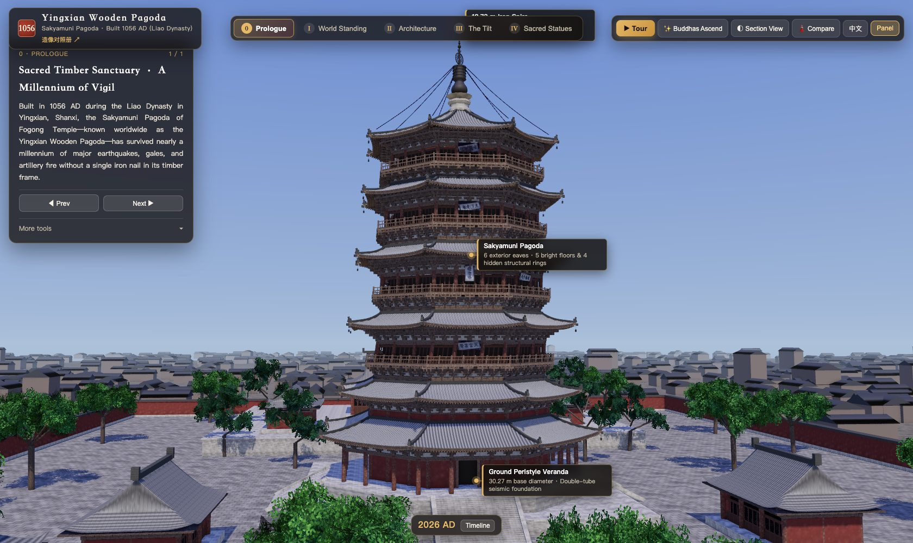

# Yingxian Wooden Pagoda · Interactive 3D

I rebuilt a 970-year-old wooden pagoda as an interactive 3D scene with Three.js + Vite.

**Yingxian Wooden Pagoda: built in 1056, 67 m tall (~22 stories), entirely wood.**
~2.85M triangles, 26 Buddha GLB models, 93 MB. 18 days, 21 iterations.

**[Live demo → haobyte.github.io/yingxian-pagoda](https://haobyte.github.io/yingxian-pagoda/)** · [Statue atlas](https://haobyte.github.io/yingxian-pagoda/statues.html)



The pagoda (Sakyamuni Pagoda of Fogong Temple, Yingxian, Shanxi) is the oldest and tallest surviving all-timber pagoda in the world. From outside it shows five floors; inside there are nine structural layers: five bright worship halls and four hidden braced rings. The scene models all of it, plus the 26 Liao-dynasty statues the pagoda houses.

## Features

- **Free orbit** around the whole pagoda and its courtyard.
- **Nine-layer explosion** that pulls apart the five bright floors and four hidden rings.
- **Core column grid**: a see-through skeleton of columns, beams and brackets, with a top-down view of the double octagonal column ring.
- **Section view**: the building is cut away layer by layer while the 26 statues stay in place.
- **Tilt timeline**: the pagoda leans to the north-east; step through the years to see it.
- **Three-tower comparison** for scale.
- **Statue atlas** (`statues.html`): every statue with its AI "present condition" reference, AI "restoration hypothesis", and a rotatable GLB model.
- English and Chinese UI, desktop and mobile.

## Quick start

Requires Node.js 22+.

```bash
npm ci
npm run dev        # http://127.0.0.1:5184
```

Other scripts:

| Command | What it does |
| --- | --- |
| `npm run build` | Production build to `dist/` |
| `npm run check` | Verifies the build: 26 models present and byte-identical to the recorded hashes |
| `npm run preview` | Serves `dist/` locally |
| `npm test` | Browser smoke test of the main scene and all models (needs Playwright) |
| `npm run test:atlas` | Same, for the statue atlas only (works with software rendering) |

For tests run `npx playwright install chromium` first. Set `CHROME_PATH` to use a local Chrome, or `BASE_URL` to test a deployed site.

The site uses relative asset paths, so it works under a GitHub Pages sub-path. A GitHub Actions workflow builds, checks and deploys `main` to Pages.

## Project layout

```
index.html, statues.html    Entry pages (main scene, statue atlas)
src/main.js                 UI, camera, interaction
src/pagoda.js, builders/    Pagoda structure and statue loading
src/section-view.js         Section view
src/timeline.js, deform.js  Tilt history
src/statues-data.js         Runtime config for the 26 statues
static/models/statues/      26 statue GLBs + per-model source records
static/comparison/          Atlas images (AI reference images) + source records
static/ref/, plaques/       On-site photos and plaque textures
data/                       Atlas catalogue, model integrity hashes
docs/                       Asset provenance
tools/                      Build checks and browser tests
```

## About the data and the models

- Dimensions and structure follow published surveys and on-site observation. They are a visualization, not a survey-grade model.
- The 26 statue models were generated from AI reference images with Tripo and are used as-is: missing parts (for example a complete lion or elephant mount) are not added. The generated shapes are not measured geometry, and some statue identities remain uncertain.
- The atlas is deliberately split into three kinds of material that should not be confused: an AI "present condition" reconstruction, an AI "restoration hypothesis" (a guess at the pre-weathering appearance, not a confirmed Liao-dynasty original), and the 3D model.
- The "photograph" column of the atlas is empty in this public release. The reference photos used to generate the AI images have no recorded source and could not be cleared for redistribution, so they were removed. The AI images themselves were generated from those photos.
- The first load downloads about 93 MB of models.

## License

- **Code**: [MIT](LICENSE).
- **Own assets** (26 GLB models, AI reference images, the author's on-site photos): [CC BY-NC 4.0](LICENSE-ASSETS.md). Attribution required, no commercial use. The models and images are AI-generated; see the notice in that file.
- **Third-party material** is not covered by the licenses above. The first-floor Sakyamuni front photograph is by Patrick20242023 on Wikimedia Commons, [CC BY-SA 4.0](https://creativecommons.org/licenses/by-sa/4.0/).
- Built with [Three.js](https://threejs.org/) and [Vite](https://vite.dev/), both MIT.

Provenance records for each model and image are in `static/models/statues/*.source.json`, `static/comparison/*.json` and `docs/asset-provenance.json`.

## Issues

Corrections to the history, dimensions or statue identification are welcome — please open an issue with a source.
